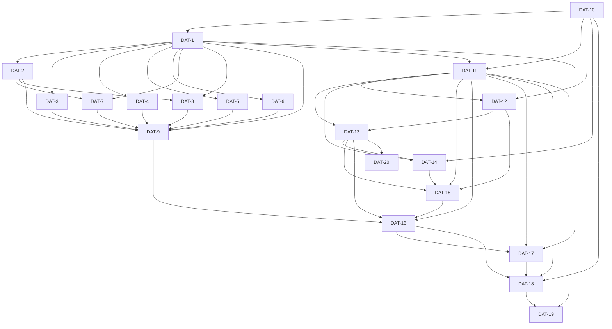

# Implementation Plan (TASKS.md)

## Dependency Graph

## DAT-10: readRuntimeConfig pure parser in models.ts
- **Slug**: read-runtime-config
Add readRuntimeConfig(parsedConfig) to skills/src/shared/models.ts. It is a pure function over the parsed .datum/config.json object and returns { kind, models: { fast, balanced, deep }, concurrency, priority, client }, with named errors for invalid input.

- **Acceptance Criteria**:
  - readRuntimeConfig({ runtime: { kind: 'fake', models: { fast: 'f', balanced: 'b', deep: 'd' } } }) returns { kind: 'fake', models: { fast: 'f', balanced: 'b', deep: 'd' }, concurrency: {}, priority: 'batch', client: 'datum' }
  - An explicit priority 'interactive' and client 'x' are returned unchanged
  - readRuntimeConfig({ runtime: { kind: 'bogus', models } }) throws an Error whose message is 'runtime_kind_unknown: bogus'
  - A runtime block missing models.balanced throws 'runtime_models_missing: balanced' (Q4 default: no invented models)
  - concurrency { m1: 0 }, { m1: 1.5 } or { m1: -2 } throws 'runtime_concurrency_invalid: m1'
  - An exported helper concurrencyFor(rc, 'unknown-model') returns 1
  - readRuntimeConfig({}) (no runtime block) throws 'runtime_block_missing', and the function never invents models (Q5 default)
  - kind 'pi' is accepted by the parser. Rejecting it is the CLI's job (Q5)
  - readRuntimeConfig does no I/O: it is a pure function of its argument
- **Files**: skills/src/shared/models.ts, skills/src/shared/models-runtime-config.test.ts
- **RED Note**: In the new vitest file skills/src/shared/models-runtime-config.test.ts, import readRuntimeConfig and concurrencyFor from './models' and assert the exact returned object for the minimal valid block, the defaults (priority 'batch', client 'datum', concurrency lookup 1), and each named error message via toThrow('runtime_kind_unknown: bogus') and the others. This fails because neither function exists. Record Q4 and Q5 provisional defaults in the test names.
- **Estimated LOC**: 110

## DAT-1: Shell seam in runBatch plus getBatchRoot accessor
- **Slug**: runbatch-shell-seam
Declare an optional `shell` global in sandbox.d.ts, export getBatchRoot() from batch.ts, and add an optional `shell` to RunBatchDeps. When deps.shell or globalThis.shell is a function, runBatch runs batchScript(steps) through it once and skips the prompt and retry logic. The hosted path (no shell) stays byte-identical. This is the thinnest end-to-end slice: a caller with a shell can run a real datum-cli batch with no LLM in the loop.

- **Acceptance Criteria**:
  - sandbox.d.ts declares `shell?(script: string, opts: { cwd: string; timeoutMs: number }): Promise<{ exit_code: number; stdout: string; stderr: string }>` as an optional global, and `npx tsc -p skills/tsconfig.json` exits 0
  - getBatchRoot() is exported from skills/src/shared/batch.ts and returns the value last passed to setBatchRoot('/x/repo'), which is '/x/repo'
  - runBatch(steps, opts, { shell, agentFn }) with a fake shell that returns exit_code 0 and a 3-row JSON array on stdout returns a BatchResult with 3 parsed steps. agentFn is called 0 times and batchCommandPrompt is not invoked
  - The shell is called exactly once per runBatch call with script === batchScript(steps), opts.cwd === getBatchRoot() and opts.timeoutMs === 600000 (BATCH_TOOL_TIMEOUT_MS)
  - With an empty batch root, opts.cwd falls back to args.repoRoot, then to process.cwd()
  - deps.shell takes precedence over globalThis.shell: when both are set, only deps.shell is called
  - A shell that rejects with Error('boom') makes runBatch return missing: true with scriptError starting 'batch_shell_threw: boom'. agentFn is called 0 times and there is no retry
  - A shell returning exit_code 3, unparseable stdout and stderr 'x'.repeat(500) makes runBatch return missing: true with scriptError === 'batch_shell_exit_3: ' + 'x'.repeat(200). agentFn is called 0 times
  - With no deps.shell and no globalThis.shell, runBatch sends the same prompt text to agentFn as before, and the existing agents.test.ts retry-path tests pass unchanged
- **Files**: skills/src/shared/sandbox.d.ts, skills/src/shared/batch.ts, skills/src/shared/agents.ts, skills/src/shared/agents-shell.test.ts
- **Depends on**: DAT-10
- **RED Note**: In a new vitest file skills/src/shared/agents-shell.test.ts, call runBatch with deps { shell: fakeShell, agentFn: vi.fn() }. Assert parsed step count 3, agentFn.mock.calls.length === 0, and the exact script/cwd/timeoutMs passed to fakeShell (compare against batchScript(steps)). Add negative cases for a rejecting shell (batch_shell_threw:) and for a non-zero exit with junk stdout (batch_shell_exit_<code>: plus the first 200 chars of stderr). Add a getBatchRoot round-trip test, a precedence test (deps.shell over globalThis.shell; set and delete the global in try/finally), and a no-shell test that asserts the agentFn prompt equals batchCommandPrompt(steps). All of these fail today because RunBatchDeps has no shell and getBatchRoot does not exist.
- **Estimated LOC**: 160

## DAT-2: verifyCommitIndependently and the retry-guard go through runBatch, with a retry-marker option
- **Slug**: agents-cli-calls-runbatch
Convert verifyCommitIndependently (agents.ts:90) and the resilientAgent retry-guard (agents.ts:172, label 'retry-guard', model 'haiku') from agent/agentFn(batchCommandPrompt(...)) to runBatch. Add an optional `retryMarker` field to runBatch's opts. With no shell, it appends `\n\n<retryMarker>` to batchCommandPrompt(steps). This is the retry-marker variant that later lanes use for the contextInlineRetryPrompt callers. context-relay.ts exports CONTEXT_INLINE_RETRY_MARKER, and contextInlineRetryPrompt is rebuilt on that constant so its output text does not change.

- **Acceptance Criteria**:
  - verifyCommitIndependently calls runBatch with label `verify-commit:<taskId>:<stage>` and model model('fast'). The source slice between `export async function verifyCommitIndependently` and `export interface ResilientAgentDeps` contains `runBatch(` and no `batchCommandPrompt(`
  - resilientAgent's dirty-worktree guard calls runBatch(guardSteps, stageOpts('cli', { label: 'retry-guard', model: 'haiku' }), { agentFn, logFn }), so an injected deps.agentFn still receives the guard call in tests
  - With a fake shell installed via globalThis.shell, verifyCommitIndependently('task-001', '/wt', ['a.ts'], 'feat', 'green') returns committed: true when the shell's log row contains a matching commit, and the agent global is called 0 times
  - runBatch(steps, { label: 'x', retryMarker: CONTEXT_INLINE_RETRY_MARKER }, { agentFn }) with no shell sends a prompt equal to contextInlineRetryPrompt(steps) as it was before the change
  - CONTEXT_INLINE_RETRY_MARKER === '# attempt 2 of 2 — the previous runner returned one of these files with bytes missing; copy the script\'s output verbatim, every byte'
  - With a shell present, retryMarker is ignored and the shell receives batchScript(steps)
  - The agents.test.ts pin at line 272 now asserts `runBatch(` instead of `batchCommandPrompt(` inside verifyCommitIndependently and still asserts the log is bounded (`..HEAD` or `-n <n>`)
- **Files**: skills/src/shared/agents.ts, skills/src/shared/context-relay.ts, skills/src/shared/agents.test.ts, skills/src/shared/agents-cli-runbatch.test.ts
- **Depends on**: DAT-1
- **RED Note**: In the new vitest file skills/src/shared/agents-cli-runbatch.test.ts, install a fake globalThis.shell (restore it in afterEach) and a vi.fn agent global. Assert that verifyCommitIndependently reaches the shell and calls agent 0 times. Drive resilientAgent with a worktree and deps.agentFn returning null, and assert the guard call goes through runBatch: with a shell it calls the shell, and without one it calls agentFn with a prompt equal to batchCommandPrompt(guardSteps). Assert the retryMarker prompt equals the old contextInlineRetryPrompt(steps) text byte for byte. Update the source-text pin in agents.test.ts (around line 272) to the runBatch form. Keep contextInlineRetryPrompt exported and working: task-009 removes it only after its callers move.
- **Estimated LOC**: 140

## DAT-3: Lane dep-merge goes through runBatch
- **Slug**: lane-dep-merge-runbatch
Convert the dep-merge call at datum-tdd-act-lane.ts:1946 from resilientAgent(batchCommandPrompt(depMergeStepList), ...) to runBatch(depMergeStepList, stageOpts('cli', { label: `dep-merge:${taskId}`, model: 'haiku' })). Remove the now-unused batchCommandPrompt and runCommandPrompt imports from the lane bundle.

- **Acceptance Criteria**:
  - datum-tdd-act-lane.ts source contains `runBatch(depMergeStepList` and contains no `batchCommandPrompt(` call
  - datum-tdd-act-lane.ts no longer imports batchCommandPrompt from './shared/batch' or runCommandPrompt from './shared/boot'
  - The dep-merge call keeps label `dep-merge:${taskId}` and model 'haiku'
  - The dep-merge result is still a BatchResult. Its failure handling (describeFailure / stepResult) is unchanged, and the existing datum-tdd-act-lane tests (test.ts, calls.test.ts, integration.test.ts) pass
  - `npx tsc -p skills/tsconfig.json` exits 0
- **Files**: skills/src/datum-tdd-act-lane.ts, skills/src/datum-tdd-act-lane-depmerge.test.ts
- **Depends on**: DAT-1
- **RED Note**: In the new vitest file skills/src/datum-tdd-act-lane-depmerge.test.ts, read datum-tdd-act-lane.ts as source text. Assert it contains `runBatch(depMergeStepList` with `label: \`dep-merge:${taskId}\`` and model 'haiku', has no `batchCommandPrompt(` call, and does not import runCommandPrompt. This fails today because line 1946 wraps batchCommandPrompt in resilientAgent. Do not edit the generated skills/datum-tdd-act-lane.js.
- **Estimated LOC**: 40

## DAT-4: datum-go act-start and preflight checks go through runBatch
- **Slug**: go-cli-calls-runbatch
Convert datum-go.ts:438 (act-start, batchCommandPrompt(actStart)) to runBatch. Convert the two runCommandPrompt callers (datum-go.ts:183 preflight-tool-check, datum-go.ts:214 preflight-gitignore) to single-step runBatch calls, keeping the same labels and models, and read the verdict from the step's exit_code and stdout. Remove the unused batchCommandPrompt import from datum-awake.ts as well.

- **Acceptance Criteria**:
  - datum-go.ts contains no `batchCommandPrompt(` and no `runCommandPrompt(` call, and imports neither symbol
  - The act-start dispatch is `runBatch(actStart, ...)` and keeps its existing label
  - preflight-tool-check and preflight-gitignore are each a runBatch call over a one-element BatchStep array whose command is the same command string runCommandPrompt received before (for example `datum gitignore-check --fix` when yolo is set)
  - A preflight step with exit_code != 0 still produces the same halt and log message as before. This is exercised by a pure helper or source pin in the test
  - setBatchCacheKey and setBatchRoot still precede the first runBatch call in datum-go.ts
  - datum-awake.ts no longer imports batchCommandPrompt, and `npx tsc -p skills/tsconfig.json` exits 0
  - The existing datum-go.test.ts passes
- **Files**: skills/src/datum-go.ts, skills/src/datum-awake.ts, skills/src/datum-go-runbatch.test.ts
- **Depends on**: DAT-1
- **RED Note**: In the new vitest file skills/src/datum-go-runbatch.test.ts, read datum-go.ts and datum-awake.ts as source text. Assert: no `batchCommandPrompt(` or `runCommandPrompt(` call in datum-go.ts; `runBatch(actStart` is present; the gitignore-check and preflight tool-check commands appear inside runBatch step arrays; the index of the first setBatchRoot( is less than the index of the first runBatch(; datum-awake.ts has no batchCommandPrompt import. All of these fail today.
- **Estimated LOC**: 90

## DAT-5: datum-tdd-act, setup and merge datum-cli calls go through runBatch
- **Slug**: act-entry-cli-calls-runbatch
Convert datum-tdd-act.ts:62 (actStart), datum-tdd-act-setup.ts:41 and datum-tdd-act-merge.ts:57 from agent(batchCommandPrompt(...)) to runBatch, keeping labels and models. Remove the unused batchCommandPrompt import from datum-tdd-act-docs.ts.

- **Acceptance Criteria**:
  - datum-tdd-act.ts, datum-tdd-act-setup.ts and datum-tdd-act-merge.ts contain no `batchCommandPrompt(` call and no batchCommandPrompt import
  - datum-tdd-act.ts dispatches `runBatch(actStart`, datum-tdd-act-setup.ts dispatches `runBatch(steps` and datum-tdd-act-merge.ts dispatches `runBatch(steps`, each with its original label
  - datum-tdd-act-docs.ts no longer imports batchCommandPrompt
  - setBatchCacheKey and setBatchRoot precede the first runBatch call in each of the three bundles
  - The existing datum-tdd-act.test.ts and datum-tdd-act-merge.test.ts pass, and `npx tsc -p skills/tsconfig.json` exits 0
- **Files**: skills/src/datum-tdd-act.ts, skills/src/datum-tdd-act-setup.ts, skills/src/datum-tdd-act-merge.ts, skills/src/datum-tdd-act-docs.ts, skills/src/act-entry-runbatch.test.ts
- **Depends on**: DAT-1
- **RED Note**: In the new vitest file skills/src/act-entry-runbatch.test.ts, read the four sources as text and assert the runBatch forms named in the ACs, the absence of `batchCommandPrompt` (call and import), and that setBatchRoot( comes before the first runBatch(. This fails today because each file calls agent(batchCommandPrompt(...)).
- **Estimated LOC**: 70

## DAT-6: datum-validate and datum-closeout datum-cli calls go through runBatch
- **Slug**: validate-closeout-runbatch
Convert datum-validate.ts:142 (verifySteps) and datum-closeout.ts:54 (collectSteps) and :171 (archiveSteps) to runBatch. Update the main-sync-steps.test.ts:233 pin to the new form, and remove the unused batchCommandPrompt import from datum-review.ts.

- **Acceptance Criteria**:
  - datum-validate.ts contains `runBatch(verifySteps` and no `batchCommandPrompt(` call or import
  - datum-closeout.ts contains `runBatch(collectSteps` and `runBatch(archiveSteps`, and no `batchCommandPrompt(` call or import
  - datum-review.ts no longer imports batchCommandPrompt
  - main-sync-steps.test.ts line ~233 asserts the absence of any `batchCommandPrompt(` call in datum-validate.ts instead of the old `agent(batchCommandPrompt(syncSteps)` pin, and the test passes
  - The existing datum-validate.test.ts and datum-closeout.test.ts pass, and `npx tsc -p skills/tsconfig.json` exits 0
- **Files**: skills/src/datum-validate.ts, skills/src/datum-closeout.ts, skills/src/datum-review.ts, skills/src/shared/main-sync-steps.test.ts, skills/src/validate-closeout-runbatch.test.ts
- **Depends on**: DAT-1
- **RED Note**: In the new vitest file skills/src/validate-closeout-runbatch.test.ts, read datum-validate.ts, datum-closeout.ts and datum-review.ts as text. Assert the runBatch(verifySteps / collectSteps / archiveSteps forms and the absence of batchCommandPrompt (call and import). This fails today. Update the existing pin in main-sync-steps.test.ts to the new form in the same lane.
- **Estimated LOC**: 70

## DAT-7: datum-plan context-inline retries go through runBatch with the retry marker
- **Slug**: plan-context-retry-runbatch
Replace the two agent(contextInlineRetryPrompt(...), ...) calls in datum-plan.ts (:82 with bootstrapOpts, :143 with stageOpts) with runBatch(inlineSteps, { ...opts, retryMarker: CONTEXT_INLINE_RETRY_MARKER }). Their result feeds mergeRelayRetry exactly as before. The hosted-path prompt text is unchanged.

- **Acceptance Criteria**:
  - datum-plan.ts contains no `contextInlineRetryPrompt(` call and does not import contextInlineRetryPrompt
  - Both retry sites call runBatch with label 'read-context-files:retry', model model('fast') and retryMarker CONTEXT_INLINE_RETRY_MARKER. The :82 site keeps bootstrapOpts('cli', ...) and the :143 site keeps stageOpts('cli', ...)
  - The retry result is still merged with mergeRelayRetry
  - datum-plan.test.ts's pin 'retries with contextInlineRetryPrompt and merges with mergeRelayRetry' is updated to assert the runBatch + CONTEXT_INLINE_RETRY_MARKER form and passes
  - `npx tsc -p skills/tsconfig.json` exits 0
- **Files**: skills/src/datum-plan.ts, skills/src/datum-plan.test.ts
- **Depends on**: DAT-2, DAT-1
- **RED Note**: Edit the pin in skills/src/datum-plan.test.ts (around line 556) so it expects `runBatch(` with `retryMarker: CONTEXT_INLINE_RETRY_MARKER` and no `contextInlineRetryPrompt(` in datum-plan.ts. It must fail against the current source before GREEN. Depends on task-002 for the retryMarker option and the constant.
- **Estimated LOC**: 40

## DAT-8: datum-properties and datum-refine context-inline retries go through runBatch
- **Slug**: properties-refine-context-retry-runbatch
Replace agent(contextInlineRetryPrompt(inlineSteps), stageOpts('cli', { label: 'read-context-files:retry', model: model('fast') })) in datum-properties.ts:80 and datum-refine.ts:101 with runBatch using retryMarker CONTEXT_INLINE_RETRY_MARKER.

- **Acceptance Criteria**:
  - datum-properties.ts and datum-refine.ts contain no `contextInlineRetryPrompt(` call and do not import it
  - Each file calls runBatch(inlineSteps, stageOpts('cli', { label: 'read-context-files:retry', model: model('fast'), retryMarker: CONTEXT_INLINE_RETRY_MARKER })) or an equivalent with the same label, model and marker, and still merges with mergeRelayRetry
  - The pins in datum-properties.test.ts (~:194) and datum-refine.test.ts (~:256) assert the new form and pass
  - `npx tsc -p skills/tsconfig.json` exits 0
- **Files**: skills/src/datum-properties.ts, skills/src/datum-refine.ts, skills/src/datum-properties.test.ts, skills/src/datum-refine.test.ts
- **Depends on**: DAT-2, DAT-1
- **RED Note**: Update the 'retries with contextInlineRetryPrompt' pins in skills/src/datum-properties.test.ts and skills/src/datum-refine.test.ts to expect `runBatch(` with the CONTEXT_INLINE_RETRY_MARKER marker and no contextInlineRetryPrompt( call. Confirm both fail against the current sources.
- **Estimated LOC**: 50

## DAT-9: Repo-wide guard: batchCommandPrompt only in batch.ts and agents.ts
- **Slug**: runbatch-only-guard
After every caller is converted, remove contextInlineRetryPrompt (and context-relay's batchCommandPrompt import) from context-relay.ts, remove the unused batchCommandPrompt import from tracker.ts, update the agent-types-ordering.test.ts pins (lines 25/63/97/114) to the runBatch form, and add a source-scan test that enforces R2.4.

- **Acceptance Criteria**:
  - A vitest scanning skills/src/**/*.ts (excluding *.test.ts) finds `batchCommandPrompt` only in skills/src/shared/batch.ts and skills/src/shared/agents.ts
  - The same scan finds `runCommandPrompt` and `contextInlineRetryPrompt` only in boot.ts, context-relay.ts and agents.ts (with contextInlineRetryPrompt removed entirely, it appears nowhere outside tests)
  - context-relay.ts still exports CONTEXT_INLINE_RETRY_MARKER, and context-relay.test.ts's contextInlineRetryPrompt case is rewritten to assert the marker text
  - tracker.ts no longer imports batchCommandPrompt
  - agent-types-ordering.test.ts pins only on runBatch( as the first batch dispatch (no batchCommandPrompt fallback), and it passes for every datum-*.ts script with setBatchCacheKey and setBatchRoot before the first runBatch
  - `npx tsc -p skills/tsconfig.json` exits 0, and `npx vitest run skills/src` passes except the known zsh failure in batch.test.ts
- **Files**: skills/src/shared/context-relay.ts, skills/src/shared/context-relay.test.ts, skills/src/shared/tracker.ts, skills/src/shared/agent-types-ordering.test.ts, skills/src/shared/runbatch-only.test.ts
- **Depends on**: DAT-2, DAT-3, DAT-4, DAT-5, DAT-6, DAT-7, DAT-8, DAT-1
- **RED Note**: The new vitest skills/src/shared/runbatch-only.test.ts walks skills/src recursively with node:fs. It collects every non-test .ts file that mentions batchCommandPrompt, runCommandPrompt or contextInlineRetryPrompt and asserts the exact allowed file sets from R2.4. It must fail now because context-relay.ts and tracker.ts still reference batchCommandPrompt. Rewrite the context-relay.test.ts case that imports contextInlineRetryPrompt so it asserts CONTEXT_INLINE_RETRY_MARKER instead. This lane runs last among the conversion lanes because removing contextInlineRetryPrompt earlier would break the plan, properties and refine sources.
- **Estimated LOC**: 90

## DAT-11: runBundle core with StageExecutor interface and FakeExecutor
- **Slug**: runner-core-fake-executor
Create skills/src/runtime/executor.ts (StageExecutor, StageRequest, StageReply, ShellFn types, and executor timeout responsibility documented), skills/src/runtime/fake-executor.ts (scripted replies by label prefix, request recording, hold/release), and skills/src/runtime/runner.ts with runBundle. runBundle loads a post-processed bundle, strips `export ` from `export const meta`, runs the body as an AsyncFunction and supplies the sandbox globals: agent, parallel, pipeline, phase, log, workflow (placeholder rejection until task-015), args, budget, shell. It calls setModelTiers with the runtime models triple. agent() resolves opts.model through the models map into StageRequest.model, sends the request to the executor and parses the reply with parseAgentJson.

- **Acceptance Criteria**:
  - runBundle({ bundlePath, args, executor, shell, skillsDirs, log, runtime, repoRoot }) resolves with the bundle's top-level return value for a bundle containing `export const meta = {...}` and a top-level `return 42`
  - Inside a bundle, typeof agent/parallel/pipeline/phase/log/workflow/shell === 'function' and typeof args/budget === 'object'
  - parallel([ok1, reject, ok2]) starts all three thunks before awaiting any (the FakeExecutor records 3 starts while held), returns [x, null, y] in input order
  - pipeline(['a','b','c'], s1, s2) runs s1 then s2 per item with each stage receiving the previous stage's result. An item whose s1 rejects yields null and s2 is not called for it (Q2 default)
  - phase('p') and log('l') each call opts.log exactly once. budget.total === null, budget.remaining() === null, and budget.spent() equals the sum of prompt_tokens + completion_tokens over replies
  - agent(prompt, { model: 'fast-id', label: 'x' }) sends a StageRequest with model equal to the resolved tier id, prompt unchanged and opts.label 'x', and returns parseAgentJson(reply.text)
  - FakeExecutor answers with the first script entry whose labelPrefix prefixes req.opts.label, otherwise the default reply. requests records { startedAt, endedAt } in call order
  - FakeExecutor.hold('h') then 3 'h…' requests gives 3 recorded starts and 0 ends, and release('h') gives 3 ends
  - The runner source contains no assignment to Math.random, and `grep -rn "fetch(\|http\|net\." skills/src/runtime --include=*.ts` outside tests and fixtures is empty
- **Files**: skills/src/runtime/executor.ts, skills/src/runtime/fake-executor.ts, skills/src/runtime/runner.ts, skills/src/runtime/runner-core.test.ts, skills/src/runtime/fake-executor.test.ts
- **Depends on**: DAT-1, DAT-10
- **RED Note**: runner-core.test.ts writes small post-processed bundle strings to a temp dir (node:fs mkdtempSync) and calls runBundle with a FakeExecutor and a vi.fn shell. It asserts the return value, the typeof of each global, parallel ordering and null mapping, pipeline per-item stage order and null skipping, budget values, and the StageRequest model resolution. fake-executor.test.ts covers prefix matching, default reply, request timestamps and hold/release (3 starts, 0 ends, then 3 ends). Both fail because skills/src/runtime/ does not exist. No contract file exists yet for StageExecutor: it is created here in executor.ts. workflow() is a stub that rejects 'workflow_not_implemented' until task-015, and agent goes straight to the executor until semaphores land in task-012.
- **Introduces Stubs**: true
- **Estimated LOC**: 330

## DAT-12: Per-model semaphores with agentType affinity and client/priority headers
- **Slug**: runner-model-semaphores
Add skills/src/runtime/semaphore.ts, a per-model-id semaphore map with FIFO waiters and an agentType-affinity handoff. Wire runner.ts agent() through it and attach X-Client and X-Priority headers from the runtime config to every StageRequest.

- **Acceptance Criteria**:
  - With concurrency { m1: 2 } and 5 held requests for m1, the FakeExecutor never records more than 2 in flight at once, and all 5 finish after release
  - A model with no concurrency entry runs 1 request at a time
  - With waiters [A1, B1, A2] queued and a finishing request of agentType A, start order is A1, A2, B1
  - With no waiter matching the finished request's agentType, the earliest-arrived waiter starts next
  - Every recorded request has headers { 'X-Client': 'datum', 'X-Priority': 'batch' } under the default runtime config
  - Over 50 queued requests the in-flight count never exceeds concurrency[model]
  - Semaphore bookkeeping for 1,000 queued requests against a FakeExecutor finishes with mean per-request overhead under 5 ms
- **Files**: skills/src/runtime/semaphore.ts, skills/src/runtime/runner.ts, skills/src/runtime/semaphore.test.ts, skills/src/runtime/runner-semaphore.test.ts
- **Depends on**: DAT-11, DAT-10
- **RED Note**: semaphore.test.ts unit-tests the semaphore directly. It covers the max-in-flight counter, FIFO order, and the [A1,B1,A2] case with an A release giving A1,A2,B1. runner-semaphore.test.ts runs a bundle that fires 5 parallel agent() calls on a held model through runBundle and asserts the max concurrent count from FakeExecutor.requests timestamps, plus the exact X-Client/X-Priority headers. It also covers the 50-request bound and the 1,000-request overhead under 5 ms. These fail because no semaphore exists and requests carry no headers.
- **Estimated LOC**: 220

## DAT-13: Per-call metrics.jsonl sink
- **Slug**: runner-metrics-jsonl
Add skills/src/runtime/metrics.ts, which appends one JSON line per executed request to <repoRoot>/.datum/runs/<runId>/metrics.jsonl with the fixed key set, and wire it into runner.ts agent(). Also wire queue_wait_ms and wall_ms timing, the error outcome, runId derivation and budget.spent().

- **Acceptance Criteria**:
  - Each executed request appends exactly one line whose keys are exactly ['ts','run_id','label','agent_type','model','prompt_tokens','completion_tokens','cached_tokens','prefill_ms','decode_ms','queue_wait_ms','wall_ms','attempt','outcome']
  - A reply with no usage and no timings writes 0 for prompt_tokens, completion_tokens, cached_tokens, prefill_ms and decode_ms
  - runId is args.runId when it is a non-empty string. Otherwise it is the runner start time formatted as YYYYMMDD-HHMMSS in UTC (deriveRunId(new Date(Date.UTC(2026,9,12,5,7,9))) === '20261012-050709'). The directory is created when absent
  - queue_wait_ms measures agent() entry to semaphore acquisition (a request held behind another on concurrency 1 shows queue_wait_ms > 0), and wall_ms measures acquisition to reply
  - An executor that throws Error('down') writes a line with outcome 'error' and the agent() call rejects with 'down'
  - A valid reply writes outcome 'ok' with attempt 1 (Q6 default)
  - An unwritable runs directory makes the call reject with the filesystem error (no silent drop)
  - No line contains the prompt text or reply text
- **Files**: skills/src/runtime/metrics.ts, skills/src/runtime/runner.ts, skills/src/runtime/metrics.test.ts
- **Depends on**: DAT-12, DAT-11
- **RED Note**: metrics.test.ts runs runBundle against a temp repoRoot with a FakeExecutor. It reads .datum/runs/<runId>/metrics.jsonl, then asserts Object.keys of each line equals the exact list in order, the zero-fill, the runId derivation (pure helper with a fixed Date), queue_wait_ms > 0 for a queued request, the 'error' outcome plus rejection, an unwritable-dir rejection (chmod 0o500 on the runs dir), and that the prompt string does not appear in the file. These fail because no metrics sink exists.
- **Estimated LOC**: 180

## DAT-14: Stage output schema validation with one tier-up retry
- **Slug**: stage-output-tier-up
Add files_written (array) and test_exit_code (integer) to STAGE_RESULT_SCHEMA.required and properties. Add skills/src/runtime/validate.ts, a validator over `as const` schemas that checks required presence and declared types. Wire runner.ts agent() to validate when opts.schema is set: log stage_output_invalid, write an 'invalid' metrics line, retry once on the next tier up, and return null on the second miss or when no distinct higher tier exists.

- **Acceptance Criteria**:
  - STAGE_RESULT_SCHEMA.required equals ['success','tests_pass','committed','read_witness','files_written','test_exit_code'], properties.files_written.type === 'array' and properties.test_exit_code.type === 'integer'. REFLECT_SCHEMA.required and SKEPTIC_SCHEMA.required still include 'read_witness'
  - validateAgainstSchema(STAGE_RESULT_SCHEMA, { success: true }) returns every missing field name, and a value { test_exit_code: 1.5 } is reported as wrongly typed integer. Types string, number, integer, boolean, array and object are all checked
  - A schema-invalid fast-tier reply logs 'stage_output_invalid: <label>: <fields>', writes one metrics line with outcome 'invalid' and attempt 1, and retries with model equal to the balanced tier id and attempt 2
  - A schema-invalid reply on retry returns null and leaves two metrics lines, both with outcome 'invalid'
  - A schema-invalid deep-tier reply is not retried: exactly one request is recorded and the result is null
  - When balanced and deep share a model id, an invalid balanced reply logs 'stage_output_invalid: <label>: no distinct higher tier' and returns null with no retry (Q4 default). A model id not in the models map, including 'haiku', is treated as fast
  - A reply that parseAgentJson cannot parse takes the invalid path
  - agent() without opts.schema returns the parsed value with no validation
  - schemas.test.ts pins the updated required lists, and assertReadWitness on the hosted path is unchanged
- **Files**: skills/src/shared/schemas.ts, skills/src/shared/schemas.test.ts, skills/src/runtime/validate.ts, skills/src/runtime/runner.ts, skills/src/runtime/runner-stage-output.test.ts
- **Depends on**: DAT-13, DAT-11, DAT-10
- **RED Note**: Extend schemas.test.ts to pin the six required STAGE_RESULT_SCHEMA fields and the files_written/test_exit_code property types. runner-stage-output.test.ts covers validateAgainstSchema directly and drives runBundle with FakeExecutor scripts for: invalid then valid (two requests, different models, attempt 1 then 2), invalid twice (null, two 'invalid' lines), a deep miss (one request), shared-model tiers (the 'no distinct higher tier' log), and a 'haiku' model treated as fast. These fail because the schema lacks the fields and the runner has no validator. Lane prompts that produce StageResult may need the two new fields. If a hosted test breaks on them, note it in the PR rather than widening scope.
- **Estimated LOC**: 260

## DAT-15: Nested workflow() resolution sharing executor, shell, semaphores and metrics
- **Slug**: runner-nested-workflow
Implement workflow() in runner.ts. { scriptPath } loads that file. { name } resolves <dir>/<name>.js over skillsDirs in order, with the first existing file winning (.datum/skills before skills_dir). A name found nowhere rejects with workflow_not_found. Children run with the same executor, shell, semaphore map and metrics sink (Q3 default) and receive the child args.

- **Acceptance Criteria**:
  - workflow({ name: 'child' }) with skillsDirs [dirA, dirB], where both contain child.js, runs dirA/child.js
  - workflow({ name: 'missing' }) rejects with an Error whose message starts 'workflow_not_found: missing' and contains both dirA and dirB
  - workflow({ scriptPath: p }) loads p regardless of skillsDirs
  - The child receives the args passed to workflow() as its `args` global, and its return value resolves the parent's await
  - With concurrency { m1: 1 }, a parent request and a child request on m1 never overlap (shared semaphore map), and child requests are written to the same metrics.jsonl
- **Files**: skills/src/runtime/runner.ts, skills/src/runtime/runner-nesting.test.ts
- **Depends on**: DAT-14, DAT-12, DAT-13, DAT-11
- **RED Note**: runner-nesting.test.ts writes parent and child bundle strings into two temp skills dirs. It asserts first-dir-wins resolution, the exact workflow_not_found message listing both directories, args passthrough, child result embedding, no overlap on a concurrency-1 model across parent and child (from FakeExecutor timestamps), and a single shared metrics file. This fails because workflow() is the task-011 stub.
- **Estimated LOC**: 120

## DAT-16: Reject datum-cli agent() calls with cli_call_bypassed_runbatch and force agent types on
- **Slug**: runner-cli-call-guard
In runner.ts agent(), reject any call whose opts.agentType === 'datum-cli' with cli_call_bypassed_runbatch: <label> before it reaches the semaphore, the executor or metrics. Q9 default: runBundle sets globalThis.datumRuntime = { agentTypes: true } before running a bundle, and agent-types.ts readAgentTypeConfig/configureAgentTypes honour that override, so stageOpts('cli', ...) yields agentType 'datum-cli' even when .datum/config.json has agent_types: false. This goes live only after every datum-cli call is on runBatch (task-009).

- **Acceptance Criteria**:
  - Inside runBundle, agent('p', { agentType: 'datum-cli', label: 'leak' }) rejects with an Error whose message starts 'cli_call_bypassed_runbatch' and contains 'leak'
  - For that call the FakeExecutor records 0 requests and metrics.jsonl gains 0 lines
  - With globalThis.datumRuntime = { agentTypes: true }, readAgentTypeConfig({ agent_types: false }).agentTypes === true, and after configureAgentTypes, stageOpts('cli', { label: 'x' }).agentType === 'datum-cli'
  - Without the override, readAgentTypeConfig({ agent_types: false }).agentTypes === false (hosted path unchanged), and the existing agent-types.test.ts passes
  - runBundle removes the override when the bundle settles, whether it resolves or rejects
- **Files**: skills/src/runtime/runner.ts, skills/src/shared/agent-types.ts, skills/src/runtime/runner-cli-guard.test.ts
- **Depends on**: DAT-15, DAT-9, DAT-11, DAT-13
- **RED Note**: runner-cli-guard.test.ts runs a bundle that calls agent with agentType 'datum-cli'. It asserts the rejection message prefix and label, zero FakeExecutor requests and no metrics line. It then unit-tests readAgentTypeConfig and stageOpts with and without globalThis.datumRuntime (reset with resetAgentTypesForTests and delete the global in afterEach), and checks that runBundle clears the override after a rejecting bundle. This fails because the runner forwards every call and agent-types.ts has no override. Q9 mechanism: a globalThis.datumRuntime flag. The bundled copy of agent-types.ts reads globals, not the runner's module instance.
- **Estimated LOC**: 110

## DAT-17: Real subprocess shell and end-to-end fixture bundles
- **Slug**: runner-e2e-fixture-shell
Add skills/src/runtime/shell.ts, a ShellFn that runs the batch script in a real subprocess via child_process.spawn('bash', ['-c', script]) with an argv vector, cwd and timeoutMs, and resolves { exit_code, stdout, stderr }. Add fixture-go.js and fixture-child.js in post-processed bundle shape. Together they exercise phase, log, agent with and without schema, parallel with a rejecting thunk, a runBatch-shaped shell call (Q8 default: printf a fixed one-row JSON array) and workflow({ name: 'fixture-child' }). Add runner.test.ts covering the happy path and the negative paths.

- **Acceptance Criteria**:
  - nodeShell('printf ok', { cwd: tmp, timeoutMs: 5000 }) resolves { exit_code: 0, stdout: 'ok', stderr: '' }, and a script exceeding timeoutMs rejects with a message containing 'timeout'
  - fixture-go.js and fixture-child.js start with `export const meta`, use a top-level `return`, and contain no `import`
  - runBundle on fixture-go.js with FakeExecutor and nodeShell returns an object deep-equal to the expected parent result, with the child result embedded, the literal 'fixture-shell-ok' from the shell step and null in the rejected thunk's slot
  - FakeExecutor.requests.map(r => r.opts.label) equals the expected label list in order
  - metrics.jsonl under the temp repo root has exactly one line per recorded request
  - The same file covers cli_call_bypassed_runbatch, workflow_not_found, a schema-invalid reply with a successful tier-up, a schema-invalid reply failing twice (null, two 'invalid' lines) and a deep miss (one request)
- **Files**: skills/src/runtime/shell.ts, skills/src/runtime/fixtures/fixture-go.js, skills/src/runtime/fixtures/fixture-child.js, skills/src/runtime/runner.test.ts
- **Depends on**: DAT-16, DAT-11, DAT-1
- **RED Note**: skills/src/runtime/runner.test.ts copies the fixtures into a temp skills dir, runs runBundle with nodeShell and a scripted FakeExecutor, and asserts the exact result object, the label list, the metrics line count and each negative path from R10.4. It fails because shell.ts and the fixtures do not exist. The fixtures are plain .js outside tsc (no allowJs). They must not import anything and must parse the shell stdout inline with JSON.parse, mirroring parseBatchResult's row shape { step, exit_code, stdout }.
- **Estimated LOC**: 280

## DAT-18: Node entry for runner and second esbuild call in build-workflows.sh
- **Slug**: runner-node-entry-build
Give runner.ts a CLI main used when it runs as skills/runtime/runner.js. It takes argv --bundle <path> --args <file> --config <path> --repo-root <dir> --skills-dir <dir> (repeatable), reads the args JSON and config, applies readRuntimeConfig, builds the FakeExecutor for kind 'fake' and nodeShell, calls runBundle, and prints the result as JSON on stdout. It exits 1 with the message on stderr when the bundle throws. Add a second esbuild call to scripts/build-workflows.sh (--platform=node) outside the datum-* loop and its meta/return checks, writing skills/runtime/runner.js with the @generated banner, plus a verify step for that banner.

- **Acceptance Criteria**:
  - main(['--bundle', b, '--args', a, '--config', c, '--repo-root', r, '--skills-dir', d]) on a bundle returning {ok:1} writes '{"ok":1}' to stdout and returns exit code 0
  - A bundle that throws Error('bad') makes main return 1 and write 'bad' to stderr
  - bash scripts/build-workflows.sh produces skills/runtime/runner.js whose first line starts with '// @generated — DO NOT EDIT. Source: skills/src/', and the script's verify stage fails if that banner is missing
  - The datum-* loop's meta/return post-processing is not applied to runner.js, and existing bundles are byte-identical apart from changes in their own sources
  - package.json dependencies are unchanged
- **Files**: skills/src/runtime/runner.ts, scripts/build-workflows.sh, skills/src/runtime/runner-main.test.ts, tests/test_build_runner_bundle.py
- **Depends on**: DAT-17, DAT-16, DAT-11, DAT-10
- **RED Note**: skills/src/runtime/runner-main.test.ts calls the exported main(argv, io) with injected stdout and stderr writers against temp bundle, args and config files. It asserts the exact stdout JSON, exit 0 and exit 1 with the stderr message. tests/test_build_runner_bundle.py (pytest) runs `bash scripts/build-workflows.sh` via subprocess with an argv list (no shell=True) and a timeout. It asserts skills/runtime/runner.js exists with the @generated banner on line 1 and does not start with `export const meta`. Both fail today. skills/runtime/runner.js is a generated file: never list or hand-edit it, the build produces it.
- **Estimated LOC**: 160

## DAT-19: datum workflow run <name> command
- **Slug**: workflow-run-cli
Add datum/workflow_run.py holding the logic, plus a workflow_app typer sub-app registered in datum/cli.py with a wrapper under 15 lines. The logic resolves the bundle at .datum/skills/<name>.js, then <skills_dir>/<name>.js via datum.skills_materialize.resolve_skills_dir. It reads the args file as JSON and the runtime block from --config (default .datum/config.json), and spawns `node skills/runtime/runner.js` with an argument vector and a timeout. It prints the runner's JSON result and maps exit codes 0/1/2.

- **Acceptance Criteria**:
  - `datum workflow run fixture --args a.json` with a stub runner printing '{"r":1}' prints {"r":1} on stdout and exits 0
  - A runner that exits 1 with 'boom' on stderr makes the command exit 1 with 'boom' on stderr
  - Exit 2 with a message on stderr for each of: bundle found in neither directory, args file missing, args file not JSON, config with no runtime block, runtime.kind unknown ('runtime_kind_unknown: <kind>'), and runtime.kind 'pi' ('runtime_kind_unavailable: pi', Q5 default)
  - The runner is spawned via subprocess with a list argv (no shell=True, no os.system) and an explicit timeout
  - The bundle lookup prefers .datum/skills/<name>.js over <skills_dir>/<name>.js
  - The datum/cli.py addition is under 15 lines, and tests/test_cli_flag_contract.py passes unchanged
  - pyproject.toml dependencies are unchanged
- **Files**: datum/workflow_run.py, datum/cli.py, tests/test_workflow_run_cli.py
- **Depends on**: DAT-18, DAT-11
- **RED Note**: tests/test_workflow_run_cli.py uses typer.testing.CliRunner (or subprocess) in a tmp_path repo with .datum/config.json and .datum/skills/<name>.js. It points the command at a stub runner, a tiny node or python script injected via a module-level runner-path seam in workflow_run.py, so tests do not need a built runner.js. It asserts stdout JSON and exit 0, exit 1 with stderr passthrough, and one test per exit-2 cause with its exact message. It fails because there is no `workflow` sub-app. The runner argv contract (--bundle/--args/--config/--repo-root/--skills-dir) comes from task-018.
- **Estimated LOC**: 200

## DAT-20: Collector reads metrics.jsonl for per-agent-type, per-stage and cached-share totals
- **Slug**: token-metrics-jsonl-collector
Extend datum/closeout/collect_token_metrics.py to also read .datum/runs/<runId>/metrics.jsonl and add per_agent_type, per_stage and cached_share to closeout-raw/token_metrics.json. Existing keys (per_phase, per-model totals) and the no_state_available semantics stay unchanged (Q1 default shape).

- **Acceptance Criteria**:
  - Given metrics.jsonl lines for agent_type 'datum-red' (prompt 100, completion 10, cached 40) and 'datum-green' (prompt 0), per_agent_type['datum-red'] == {calls: 1, prompt_tokens: 100, completion_tokens: 10, cached_tokens: 40}
  - per_stage keys are label prefixes (text before the first ':') with the same four totals
  - cached_share['datum-red'] == 0.4 (rounded to 4 decimals), and cached_share['datum-green'] == 0.0 when prompt_tokens is 0
  - A missing metrics.jsonl yields per_agent_type == {}, per_stage == {} and cached_share == {} with exit 0, and the existing status semantics are unchanged
  - A malformed line 3 makes the collector exit non-zero with a message containing 'line 3'
  - The existing tests in tests/test_closeout_collectors.py and tests/test_closeout_cli.py pass unchanged, and per_phase output is unchanged
- **Files**: datum/closeout/collect_token_metrics.py, tests/test_closeout_token_metrics_jsonl.py
- **Depends on**: DAT-13
- **RED Note**: tests/test_closeout_token_metrics_jsonl.py (pytest) builds a tmp repo with .datum/runs/<runId>/metrics.jsonl, using the exact key set produced by task-013. It runs the collector as a module via subprocess with an argv list and a timeout, then asserts the exact per_agent_type, per_stage and cached_share dicts, the empty-dict case for a missing file with exit 0, and the non-zero exit naming 'line 3' for a malformed line. These fail because the collector reads only SQLite today.
- **Estimated LOC**: 150
